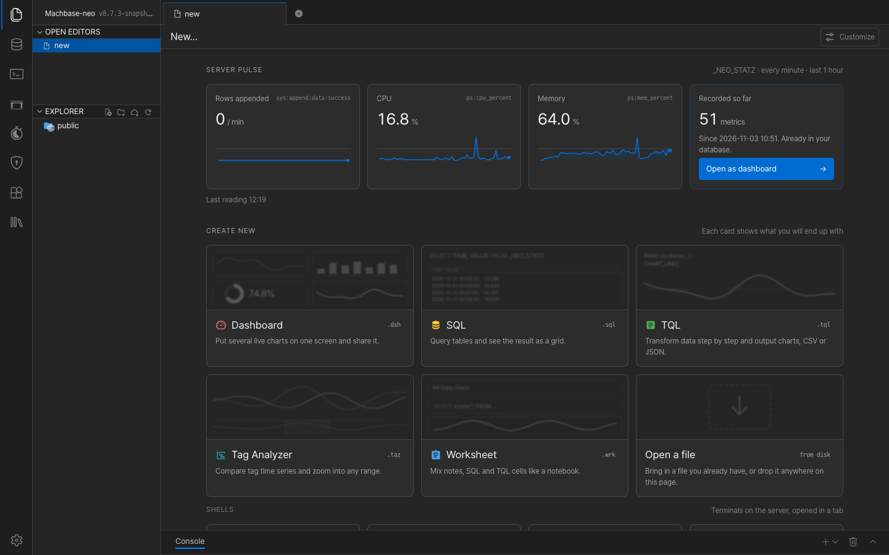
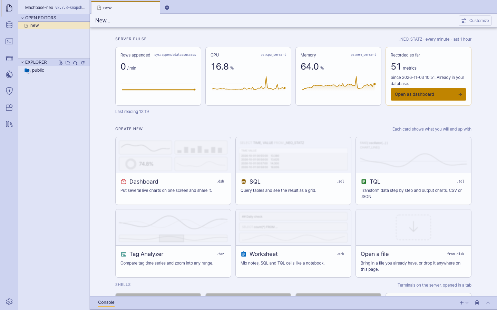
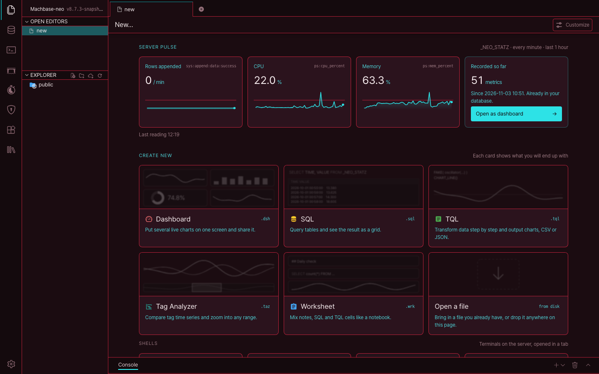
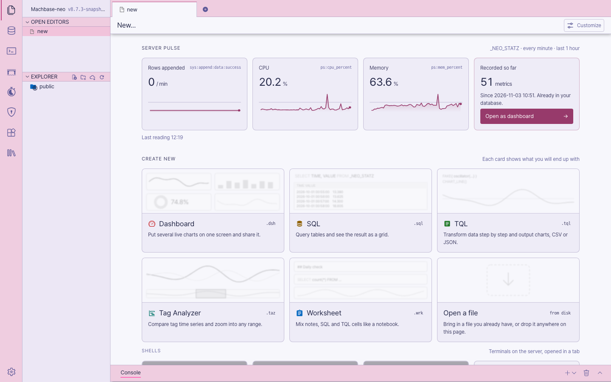
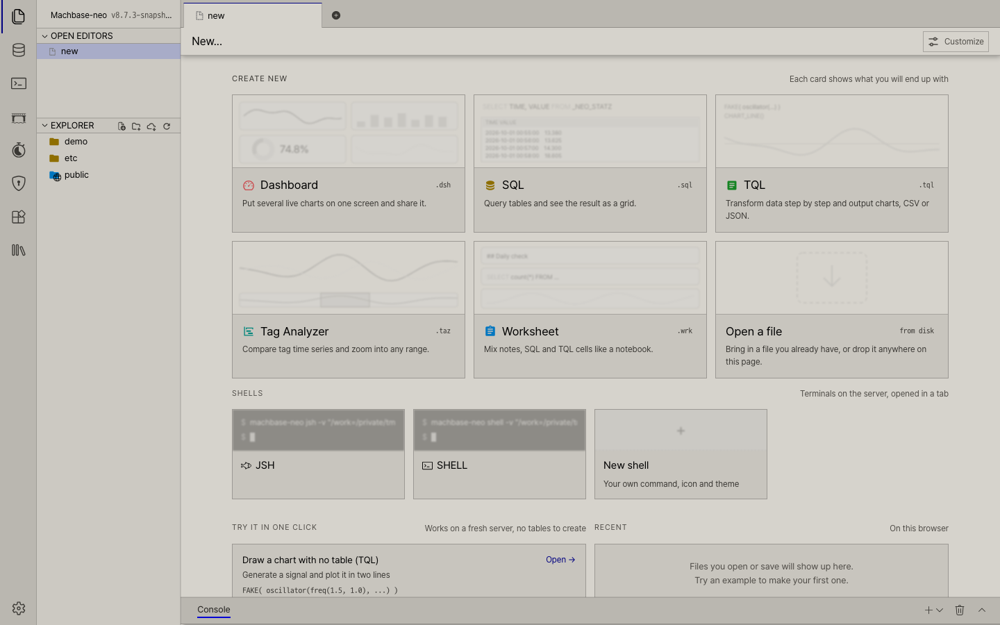

# Theme Builder

machbase-neo 웹 UI 의 색 테마를 미리보기를 보면서 직접 만들고, 클릭 한 번으로 바꿔 쓸 수 있습니다.
기본 제공 Dark 에서 시작하거나, 패키지에 들어 있는 프리셋 **Light**, **Cyberpunk**, **Aemeath**, **Cement 98** 중
하나에서 시작하세요. 프리셋은 그대로 쓸 수도 있습니다. 패키지를 설치하면 **Settings → Theme** 에 나옵니다.

| Dark | Light |
| --- | --- |
|  |  |
| **Cyberpunk** | **Aemeath** |
|  |  |
| **Cement 98** | |
|  | |

machbase-neo 8.7.4 이상이 필요합니다.

## 열기

App Store 에서 패키지를 설치한 뒤 **Settings**(왼쪽 바 맨 아래 톱니바퀴) → **Theme** →
**Open Theme Builder** 를 엽니다. PACKAGES 목록에서 패키지를 바로 열어도 됩니다.

## 테마 만들기

1. **Start from** 에서 시작할 테마를 고릅니다. 지금 쓰고 있는 테마, Dark, 프리셋, 직접 만든 테마 중
   하나입니다. 프리셋 자체는 바뀌지 않습니다. 무언가 바꾼 뒤 저장되는 것이 내 사본입니다.
2. **Colors** — 기본색부터 정합니다. **Frame**(작업 영역을 둘러싼 바), **Content**(각 탭 안의 페이지 — 에디터, 결과, New tab),
   **Text**, **Accent**, **Borders**(구분선과 카드·메뉴·대화상자·입력란의 테두리 등 모든 선), 그리고
   두 가지 상태 색 **Hover**(포인터가 올라간 것)와 **Selection**(선택한 줄)입니다. 나머지는 모두 이 색들을
   따라가므로, 이것만 정해도 테마 하나가 완성됩니다. 입력 중인 입력란이나 Tab 키로 간 버튼에는
   Accent 를 따르는 **Focus outline** 색의 테두리가 그려집니다.
3. 그다음 눈에 띄게 하고 싶은 부분을 조정합니다.
   - **기본색 아래의 묶음** — **Surfaces**(Layer: 카드·대화상자·메뉴), **Text**(Sub text, Icons,
     Text on color), **Controls**(Scrollbar), **Signals**(Success, Warning, Error, Info, 회색 Neutral과
     그 글자색)입니다. 하나를 바꾸면 그 색을 쓰는 화면의 모든 부분이 따라 바뀝니다. Hover 를 바꾸면
     모든 hover 가 한꺼번에 바뀝니다.
   - **Using it** — 각 공용 색 아래에는 그 색을 그대로 쓰는 것이 모두 나옵니다. 화면 부분(왼쪽 바,
     탭 바와 열린 탭, 사이드 패널, 콘솔, 표, 입력란, 대화상자, 메뉴, 툴팁)과 그 색을 따라가기만 하는
     공용 색(Frame 아래 *Section headers*, Content 아래 *Drawers*, Accent 아래 *Primary button*·
     *Focus outline*)입니다. **Customize** 하기 전까지 그 색을 따라가고, Customize 하면 다른 색이
     바뀌어도 그대로 있습니다. **Use \<color\>** 를 누르면 다시 따라갑니다. 예를 들어 표의 hover 만 다른
     hover 와 다르게 할 수 있습니다.

   공용 색마다 그 색이 어디에 보이는지 한 줄로 적혀 있고(포인터를 올리면 전체 목록), 부분의 줄마다
   무엇을 따라가는지 적혀 있습니다. 기본색 줄에는 함께 바뀌는 공용 색이(*Moves: Primary button · Focus outline…*),
   계산되는 색 줄에는 어느 색에서 오는지가(*from Content*) 적혀 있습니다. **Selection**(선택한 줄)과
   성공 / 경고 / 오류 / 정보 색은 따로 정하는 색이라 Accent 나 Content 를 바꿔도 그대로입니다. 시작한 테마가 어떤 부분을 그 색보다 진하거나 연하게 그려 두었으면
   그렇게 적힙니다(*follows Accent · darker, as Light has it*). 바탕색은 글자색을 바꾸지 않습니다.
   **Content** 를 밝게 바꿔도 **Text** 를 바꾸기 전까지 글자는 그대로이고, 읽기 어려워진 곳은
   미리보기 아래 대비 검사가 알려 줍니다.
4. **미리보기를 확인합니다.** 장면은 여섯 개이고, 모두 웹 UI 를 내 색으로 그린 것입니다.
   **Workspace**(왼쪽 바, 탭, 사이드 패널, 에디터, 결과, 콘솔), **Explorer**(사이드 패널의 목록인
   DB 탐색기와 패키지, 그리고 표 페이지), **New tab**(Customize 를 연 상태 — 옆의 Widgets 패널이 드로어), **Dialogs**(배경 위의 대화상자, 입력란, 버튼,
   메뉴, 툴팁), **Status**(배지, 상태 점, 메시지, 알림, 로그 레벨, 그리지 못한 탭, 토스트), **Sign-in** 입니다.
   탭마다 담긴 색의 개수가 표시됩니다. 색 행에 포인터를 올리면 그 색이 있는 장면이 나타나
   칠하는 부분에 테두리가 표시되고, 그 색이 나오는 모든 장면의 탭에 불이 들어옵니다. 미리보기의 아무 부분이나 클릭하면
   그 부분의 색으로 이동합니다. 미리보기 아래의 대비 검사가 글자가 읽기 어려워지면 알려 줍니다.
5. **Sign-in page** — **Choose a picture…** 로 로그인 상자 뒤에 내 그림을 넣습니다. 미리보기의
   *Sign-in* 탭에서 볼 수 있습니다. 그림은 테마와 함께 원본 그대로 보관됩니다(SVG 이거나 10 MB 를
   넘는 파일은 너비 최대 1920 px 의 WebP 로 바꿉니다). **Use the web UI's picture** 를 누르면 다시
   뺍니다.
6. **All tokens** 에는 웹 UI 의 모든 색이 나열됩니다. 정확한 값 하나를 정하고 싶을 때 씁니다.
   토큰에 포인터를 올리면 색 행처럼 미리보기에 그 토큰이 칠하는 곳이 표시됩니다.
   **Cursor effect** 로 포인터 효과를 더할 수 있습니다(선택 사항).

코드 에디터, 차트, 터미널의 밝은 / 어두운 모양은 Content 색에 맞춰 저절로 정해집니다. 밝은 테마를
만들려면 Light 프리셋에서 시작하는 것이 가장 빠릅니다.

## 저장하고 쓰기

- **Use this theme** 는 테마를 저장하고 웹 UI 를 바로 그 테마로 바꿉니다. **Undo** 로 되돌립니다.
  아무것도 바꾸지 않았으면 시작한 테마(Dark, 프리셋, 내 테마)를 그대로 쓰고, 사본은 만들지 않습니다.
- **Save** 는 바꾸지 않고 저장만 합니다. **Save ▾ → Save as new theme** 로 다른 버전을 하나 더
  저장합니다. 둘 다 무언가 바꿔야 쓸 수 있습니다. 그대로인 프리셋은 사본이 필요 없습니다.
- 언제든 **Settings → Theme** 에서 바꿀 수 있습니다. Dark 와 프리셋은 *Ready to use* 에, 직접 만든
  테마는 *My themes* 에 있습니다. 카드마다 그 테마로 그린 웹 UI 가 보이고, 내 테마의 **Edit** 를
  누르면 빌더에서 그 테마가 열립니다.

테마는 서버가 아니라 **이 브라우저**에 보관됩니다. 누가 로그인하든 그 브라우저의 것입니다. 로그인
페이지는 이 브라우저에서 고른 테마와 그 그림으로 보입니다. 테마를 다른 브라우저나 컴퓨터로 옮기려면
**CSS ▾ → Export CSS** 로 내보낸 뒤 그곳에서 **Import CSS** 로 가져오세요. CSS 에는 색만 담기므로
로그인 그림은 그곳에서 다시 고르세요.

---

빌더 자체를 만들거나 고치려면 [DEVELOPMENT.md](DEVELOPMENT.md) 를 보세요.
