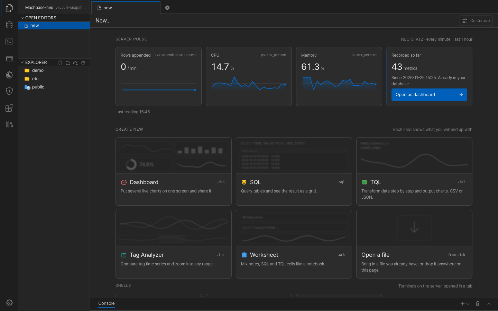
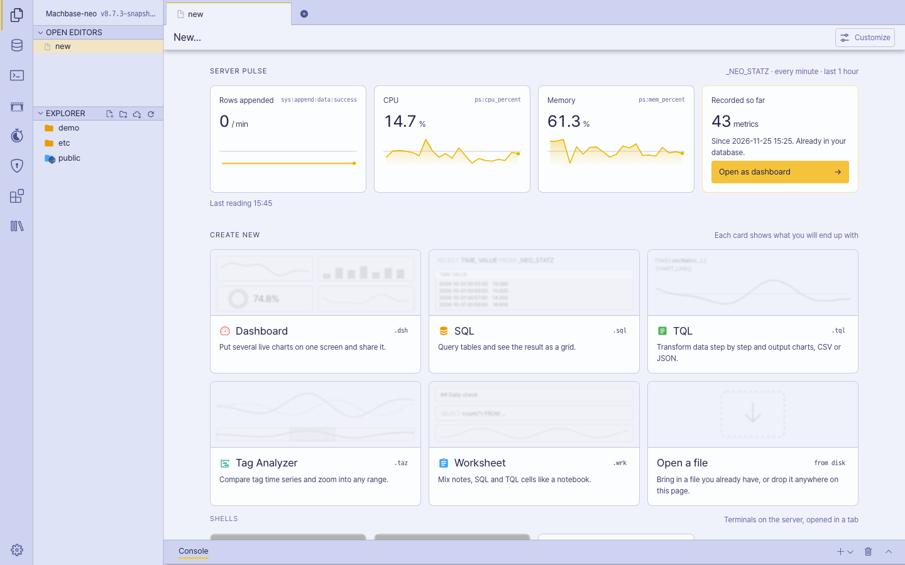
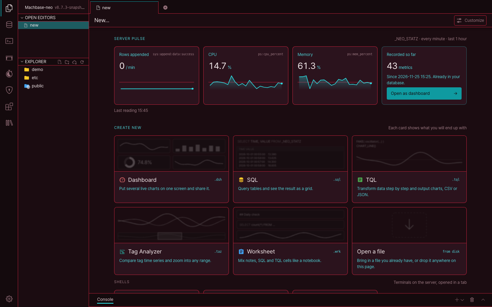
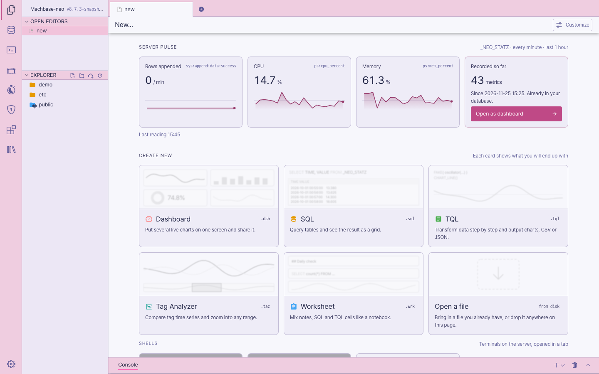
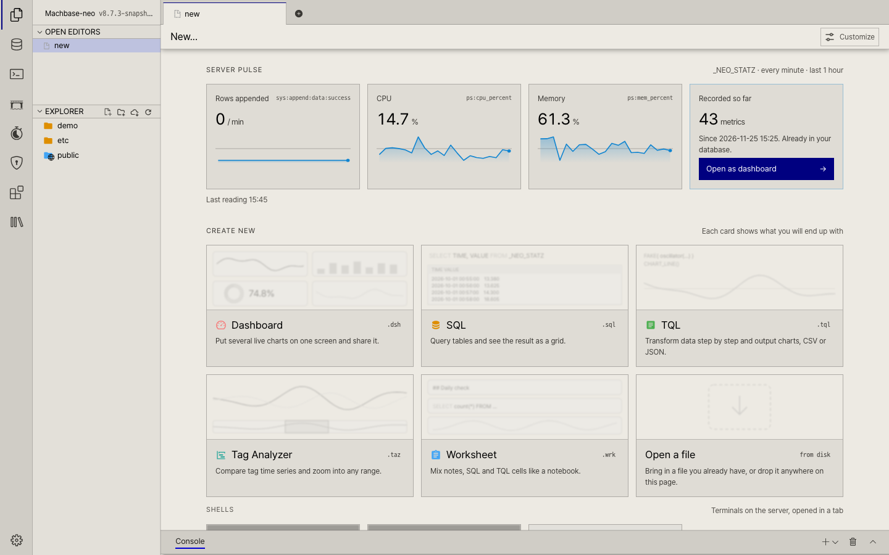

# Theme Builder

Make your own color theme for the machbase-neo web UI — with a live preview — and switch to it in
one click. Start from the built-in Dark or from one of the presets that come with the package:
**Light**, **Cyberpunk**, **Aemeath** and **Cement 98**. The presets can also be used as they are.
Package apps that load the Theme Builder's theme script follow the theme too.

| Dark | Light |
| --- | --- |
|  |  |
| **Cyberpunk** | **Aemeath** |
|  |  |
| **Cement 98** | |
|  | |

Requires machbase-neo 8.9.0 or later. Themes are an experiment: they show only while the server's
experiment mode is on.

## Open it

After installing the package from the App Store, open it from the PACKAGES list. (The web UI's
Settings menu has no Theme item in this version; it comes back once packages can add to it.)

## Make a theme

1. **Start from** a theme: the one you are using now, Dark, a preset, or one of your own themes.
   The presets themselves never change — what you save, once you change something, is your copy.
2. **Colors** — begin with the basics: **Frame** (the bars around the workspace), **Content**
   (the page inside each tab — editors, results, the New tab), **Text**, **Accent**, **Borders** (every line — dividers and the outlines of
   cards, menus, dialogs and inputs), and the two state colors **Hover** (what the pointer is over)
   and **Selection** (the selected row). Everything else follows them, so these already give you a
   whole theme. An input you are typing in, or a button reached with Tab, is outlined in the
   **Focus outline** color, which follows Accent.
3. Then adjust what you want to stand out:
   - **The groups under the basics** — **Surfaces** (Layer: cards, dialogs, menus), **Text** (Sub text,
     Icons, Text on color), **Controls** (Scrollbar) and **Signals** (Success, Warning, Error, Info, the
     Neutral gray, and their text). Change one and every part of the screen using it follows: Hover
     moves every hover at once.
   - **Using it** — under each shared color, everything that is that color: the parts of the screen
     (the left bar, the tab bar and its open tab, the side panel, the console, tables, inputs, dialogs,
     menus, tooltips) and the shared colors that simply follow it (*Section headers* under Frame,
     *Drawers* under Content, *Primary button* and *Focus outline* under Accent). Each follows its color
     until you **Customize** it; then nothing else changes it, and **Use \<color\>** lets it follow
     again. The table's hover, say, can differ from every other hover.

   Under each shared color the builder tells you where it shows (*Tab bar · Console…*; the whole
   list when you point at it), and every part's row what it follows. A basic color's row also lists
   the shared colors that change with it (*Moves: Primary button · Focus outline…* under Accent), and a worked-out
   color says where it comes from (*from Content*). **Selection** (the selected row) and the
   success / warning / error / info colors are colors of their own: changing Accent or Content leaves them. When the theme you started from
   draws a part as a shade of that color, the row says so (*follows Accent · darker, as Light has it*).
   A background never changes a text color: change **Content** to a light color and the text stays
   as it is until you change **Text** — the contrast checks under the preview say what no longer reads.
4. **Watch the preview.** Six scenes, each the web UI drawn in your colors: **Workspace** (the
   left bar, tabs, side panel, editor, results, console), **Explorer** (the side panel's lists — the
   DB explorer and the packages — and a table's page), **New tab** (with Customize open: its Widgets panel is a drawer), **Dialogs** (a dialog over its
   backdrop, inputs, buttons, a menu, a tooltip), **Status** (badges, status dots, messages, notices,
   log levels, a tab that failed to draw, a toast) and **Sign-in**. Each tab says
   how many colors it holds. Point at a color's row and the preview shows a scene it is in, with
   the parts it paints outlined, and the tabs of every scene it shows in light up. Click any part of the
   preview to jump to its color. The contrast checks under the preview warn you when text becomes
   hard to read.
5. **Sign-in page** — **Choose a picture…** puts your own picture behind the sign-in box; the
   *Sign-in* tab of the preview shows it. The picture is kept with the theme as it is (an SVG,
   or a file over 10 MB, is made into a WebP at most 1920 px wide). **Use the web UI's picture**
   takes it away again.
6. **All tokens** lists every color the web UI has, for when you want one exact value; point at
   one and the preview outlines what it paints, as it does for a color's row.
   **Cursor effect** adds an optional pointer effect.

Light or dark — the look of the code editor, charts and terminal — follows your Content color by
itself. To make a light theme, starting from the Light preset is the quickest way.

## Save and use it

- **Use this theme** saves it and switches the web UI to it right away. **Undo** takes you back.
  With nothing changed it switches to the theme you started from as it is — Dark, the preset, or
  your theme — and saves no copy.
- **Save** keeps it without switching; **Save ▾ → Save as new theme** keeps a second version. Both
  wait until you change something: a preset as it is needs no copy.
- Switch at any time here: choose a card on the left — Dark, a preset or one of your themes — and
  **Use this theme**. **Delete** on one of your themes removes it (the one in use goes back to Dark).

Your themes are kept **in this browser** — the browser's, whoever signs in on it — not on the server.
The sign-in page shows the theme chosen in this browser, and its picture. To take a theme
to another browser or computer, use **CSS ▾ → Export CSS** and then **Import CSS** there — the CSS
carries the colors; choose the sign-in picture there again.

## Your package in the theme

A package's own app does not take the web UI's theme by itself: it is a page of its own in its tab.
The Theme Builder serves the script that dresses it in the theme in use — one line in the app's
`<head>`:

```html
<script src="/public/neo-pkg-theme-builder/cgi-bin/theme/v1/sync"></script>
```

[example/](example/README.md) has how to load it, which token is for what, the rules, and a page drawn
with it; [contract/theme-v1.md](contract/theme-v1.md) is what an app may count on.

## Versions

| Theme Builder | machbase-neo | Token list (neo-web) | Theme contract | Changes |
| --- | --- | --- | --- | --- |
| 1.1.0 | 8.9.0 or later | dev-next@fc8d4728 | v1 (revision 1) | Keeps the theme state and the user's themes itself; serves theme-sync to package apps; carries its own token list |
| 1.0.0 | 8.7.2 or later | read from the server | — | First release |

---

Building or changing the builder itself? See [DEVELOPMENT.md](DEVELOPMENT.md).
