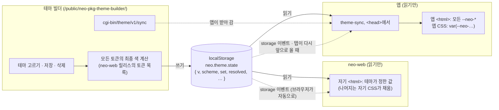

# 패키지 앱에 웹 UI 테마 입히기

[English](README.md)

패키지의 앱(`main.html`, 앱 탭에서 열림)은 iframe 안의 별도 페이지라서, 웹 UI가 입은 테마(웹 UI
`<html>`의 `--neo-*` 변수)가 앱까지 오지 않습니다. 테마 빌더가 테마를 들여오는 스크립트 하나를
제공합니다. 앱은 그 스크립트를 불러오고 `var(--neo-<토큰>)`으로 그리기만 합니다. 토큰 이름은 테마
빌더가 보여 주는 이름과 같습니다. 앱 안에 복사해 둘 것은 없습니다.

| 파일 | 내용 |
| --- | --- |
| `/public/neo-pkg-theme-builder/cgi-bin/theme/v1/sync` | **theme-sync**, theme 계약 v1([contract/theme-v1.md](../contract/theme-v1.md)). 첫 화면 전에 앱 `<html>`에 테마 토큰을 **전부** 넣고, 바뀔 때마다 따라갑니다. |
| `index.html` (여기) | 이 스크립트로 그린 페이지 — 목록, 카드, 입력, 버튼, 상태 색, 표, 캔버스. `/public/neo-pkg-theme-builder/example/`을 열고 테마 빌더에서 테마를 고르면 따라가는 것을 볼 수 있습니다. |
| `theme-sync.d.ts` (여기) | TypeScript 앱용 타입. 앱 소스에 복사해서 씁니다. |

서버에 **테마 빌더 1.1.0 이상**이 있어야 합니다(앱 README에 적어 두세요). 스크립트는 테마 빌더의
것입니다.

## 왜 모든 토큰을 넣나

테마는 일부 토큰만 정합니다(Light는 134개 중 92개, Cyberpunk는 69개). 테마가 없으면(Dark) 하나도
정하지 않습니다. 웹 UI의 Dark 색은 변수가 아니라, 자기 CSS의
`var(--neo-side-bg, var(--neo-bg-panel, #252525))`에서 두 번째 값입니다. 테마가 정하지 않은 부분
토큰은 따라가는 토큰의 색을 씁니다. Light는 Drawers(`bg-panel`)는 정하지만 사이드 패널의
`side-bg`는 정하지 않고, 웹 UI는 사이드 패널을 Drawers 색으로 그립니다.

테마를 고르면 테마 빌더가 이 규칙대로 모든 토큰의 최종 색을 계산해서(테마의 값 → 따라가는 토큰 →
Dark 기본값) 지금 쓰는 테마와 함께 저장합니다. 스크립트는 그 값을 앱 페이지에 전부 넣습니다. 그래서
앱은 `var(--neo-side-bg)`처럼 기본값 없이 써도 Dark를 포함한 모든 테마에서 웹 UI와 같은 색을
받습니다.

## 테마가 앱까지 가는 길



| 쪽 | 하는 일 | 하지 않는 일 |
| --- | --- | --- |
| 테마 빌더 | 테마 상태의 주인: `neo.theme.state`를 쓰는 유일한 페이지. 사용자 테마와 로그인 사진을 보관. theme-sync 제공. | 웹 UI에 요청하기 |
| neo-web | 상태를 읽어 테마가 정한 값을 자기 `<html>`에 입힘. 실험 모드에서만. | 테마 상태 쓰기 |
| 앱 | theme-sync를 불러오고 `var(--neo-*)`로 그림. 직접 칠하는 것만 `neo-theme-change` 때 다시 그림. | 자기 색 쓰기, 저장소 쓰기, 테마 요청 |

## 적용 방법

앱 페이지 `<head>`에 앱의 스타일시트를 먼저, 그다음 스크립트를 넣습니다. 첫 화면 전에 테마가 들어가야
하므로 `defer`, `async`, `type="module"` 없이 일반 스크립트로 넣습니다. `side.html`에도 같은 줄을
넣습니다.

```html
<link rel="stylesheet" href="app.css">
<script src="/public/neo-pkg-theme-builder/cgi-bin/theme/v1/sync"></script>
```

그다음 `var(--neo-<토큰>)`으로 기본값 없이 그립니다.

직접 색을 칠하는 코드(차트, 캔버스)는 시작할 때 한 번 읽고, 바뀔 때 다시 읽습니다.

```js
const read = (t) => getComputedStyle(document.documentElement).getPropertyValue('--neo-' + t).trim();
chart.setColor(read('accent-main'));
window.neoThemeSync.onChange((d) => chart.setColor(d.vars['accent-main']));   // 또는 window의 'neo-theme-change'
```

테마 빌더와의 관계를 `package.json`의 `dependencies`에 적지 마세요. 그 칸은 패키지가 자기
`node_modules`에 설치하는 라이브러리용이라, `pkg`가 사본을 받아 오려고 합니다.

## 어떤 토큰을 어디에

계약이 보장하는 토큰은 [contract/theme-v1.tokens](../contract/theme-v1.tokens)에 있습니다.

| 용도 | 토큰 |
| --- | --- |
| 페이지(Content) · 떠 있는 카드와 대화상자(Layer) · 드로어 | `bg-secondary` · `bg-elevated` · `bg-panel` |
| 차트·영상 영역 · 대화상자 뒤 가림막 | `bg-canvas` · `bg-backdrop` |
| 글자 · 보조 · 3차 · 도움말 · 비활성 · 아이콘 | `text-primary` · `text-secondary` · `text-tertiary` · `text-muted` · `text-disabled` · `text-icon` |
| Accent나 상태 색으로 채운 면 위의 글자 | `text-on-accent` |
| 선 · 진한 선 · 포커스 테두리 | `border-color-default` · `border-color-strong` · `border-color-focus` |
| hover · 선택된 행과 그 글자 | `hover-bg` (행은 `list-hover-bg`) · `selected-bg` · `selected-text` |
| Accent · 링크 · 버튼 | `accent-main` · `accent-hover` · `accent-text` · `button-primary-bg` · `button-danger-bg` · `button-disabled-bg` |
| 상태: 페이지 위 글자 · 점, 막대, 배지 | `success-text` `warning-text` `error-text` · `success-main` `warning-main` `error-main` `info-main` `neutral-main` `status-none` |
| 목록·트리 (사이드 패널의 것) | `side-bg` `side-header-bg` `side-text` `side-text-muted` `side-icon` `side-hover-bg` `side-selected-bg` |
| 표 | `table-header-bg` `table-header-text` `table-stripe-bg` `table-row-hover-bg` `table-row-selected-bg` |
| 입력란 | `field-bg` `field-border` `field-icon` `field-error-border` `field-disabled-bg` |
| 대화상자 · 메뉴 · 툴팁 | `dialog-bg` `dialog-border` `dialog-title-text` · `menu-bg` `menu-border` `menu-item-hover-bg` `menu-item-icon` `menu-shadow` · `tooltip-bg` `tooltip-text` `tooltip-border` |
| 스위치 · 스크롤바 | `switch-*` · `scrollbar-*` |
| 모서리 · 그림자 | `calc(4px * var(--neo-radius-scale))` · `shadow-sm` `shadow-md` `shadow-lg` `shadow-xl` |
| 파일 종류 아이콘 (앱이 파일을 보여 줄 때) | `icon-*` |

앱이 쓰지 않는 것: `gnb-*`, `tabbar-*`, `console-*`, `sub-tab-active-bg`(웹 UI 자신의 틀)와
`fx-cursor`. 스크립트가 이것들도 넣지만 계약으로 보장하지는 않습니다.

## 규칙

1. **색은 토큰으로.** 앱 CSS는 표의 `var(--neo-<토큰>)`을 기본값 없이 씁니다(스크립트가 전부 넣음).
   자기 색은 쓰지 않습니다(`transparent`, `currentColor`, `inherit`은 색이 아님). 앱에만 있는 색은
   토큰을 덮어쓰지 말고 자기 이름(`--my-*`)으로 만듭니다.
2. **화면 부분에 맞는 토큰**: 목록은 사이드 패널 색, 표는 표 색, 입력란은 입력란 색. 공용 색을 쓰지
   않아야 테마가 그 부분에 준 색이 앱에도 갑니다.
3. **상태 색: 페이지 위 글자는 `*-text`, 채움은 `*-main`**, 채움 위 글자는 `text-on-accent`.
4. **연한 색은 섞어서**: `color-mix(in srgb, var(--neo-success-main) 16%, transparent)`.
5. **모서리는 테마의 둥글기를 따라**: `calc(<px> * var(--neo-radius-scale))`.
6. **밝기는 속성으로.** 스크립트가 `<html data-neo-scheme="light|dark">`와 `color-scheme`을
   넣습니다. 한쪽 밝기용 그림이나 아이콘은 색을 읽지 말고 `:root[data-neo-scheme="light"] …`로
   고릅니다.
7. **직접 칠하는 코드는 시작할 때 읽고, 바뀔 때마다 다시 읽습니다**(`neoThemeSync.onChange` 또는
   `window`의 `neo-theme-change`). 첫 화면에서 변경 이벤트가 온다는 것은 보장하지 않으니 처음 한
   번은 직접 읽습니다.
8. **읽기만.** 앱은 `neo.theme.state`나 다른 테마 저장소에 쓰지 않고, 테마를 요청하지 않습니다.

## 앱 확인하기

- 테마가 켜져 있어야 합니다: 서버의 실험 모드가 켜져 있을 때만입니다. 꺼져 있으면 앱을 포함한 모든
  페이지가 Dark입니다.
- 스크립트가 있는지: `/public/neo-pkg-theme-builder/cgi-bin/theme/v1/sync`가
  `Content-Type: text/javascript`, `X-Neo-Theme-Contract: 1`로 응답해야 합니다. 테마 빌더가 없으면
  404이고 앱은 색을 받지 못합니다.
- 앱을 앱 탭에 열어 둔 채로 테마 빌더에서 Light, 다음에 Cyberpunk를 고르고, 앱을 별도 탭에 열어서도
  한 번 해 봅니다. 두 번 모두 따라가고, 새로고침해도 유지되어야 합니다.
- `node --test test/example.test.js`(여기)가 예제 페이지가 규칙을 지키는지 검사합니다.
