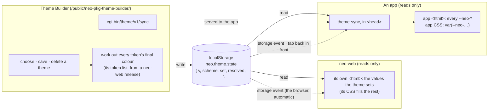

# A package app in the web UI's theme

[한국어](README.ko.md)

A package's app (`main.html`, opened in an app tab) is a page of its own inside an iframe: the theme
the web UI wears — the `--neo-*` variables on the web UI's `<html>` — does not reach it. The Theme
Builder serves one script that brings the theme in: an app loads it and draws with
`var(--neo-<token>)`, the same token names the Theme Builder lists. Nothing is copied into the app.

| File | What it is |
| --- | --- |
| `/public/neo-pkg-theme-builder/cgi-bin/theme/v1/sync` | **theme-sync**, the theme contract v1 ([contract/theme-v1.md](../contract/theme-v1.md)). Sets **every** theme token on the app's `<html>` before the first paint and follows every change. |
| `index.html` (here) | A page drawn with it — lists, a card, inputs, buttons, signals, a table, a canvas. Open `/public/neo-pkg-theme-builder/example/`, then choose a theme in the Theme Builder to see it follow. |
| `theme-sync.d.ts` (here) | Types for a TypeScript app: copy it into the app's sources. |

The app needs **Theme Builder 1.1.0 or later** on the server (say so in the app's README): the
script is the Theme Builder's.

## Why every token is set

A theme sets only some tokens (Light 92 of 134, Cyberpunk 69), and with no theme — Dark — none: the
web UI's dark colours are not variables, they are the second value of
`var(--neo-side-bg, var(--neo-bg-panel, #252525))` in its own CSS. A part's token a theme leaves out
shows what it falls back to: Light sets Drawers (`bg-panel`), not the side panel's `side-bg`, and the
web UI draws its side panel in Drawers.

When a theme is chosen, the Theme Builder works out every token's final colour that way — the theme's
value, else the token it falls back to, else the dark default — and keeps them with the theme in use.
The script puts all of them on the app's page. An app writes `var(--neo-side-bg)` with no default and
gets the web UI's colour under every theme, Dark included.

## How a theme reaches an app



| Side | Does | Does not |
| --- | --- | --- |
| Theme Builder | Owns the theme state: the one page that writes `neo.theme.state`. Keeps the user's themes and their sign-in pictures. Serves theme-sync. | Ask the web UI for anything. |
| neo-web | Reads the state, wears the values the theme sets on its own `<html>`. Only in experiment mode. | Write the theme state. |
| An app | Loads theme-sync; draws with `var(--neo-*)`; redraws what it paints itself on `neo-theme-change`. | Name a colour of its own; write storage; ask for a theme. |

## Setting it up

In the app's page, in `<head>`: the app's stylesheets, then the script — a plain script, not
`defer`, `async` or `type="module"`, so the theme is on before the first paint. A `side.html` takes
the same line.

```html
<link rel="stylesheet" href="app.css">
<script src="/public/neo-pkg-theme-builder/cgi-bin/theme/v1/sync"></script>
```

Then draw with `var(--neo-<token>)`, no default.

Code that paints colours itself (a chart, a canvas) reads them when it starts, and again when they
change:

```js
const read = (t) => getComputedStyle(document.documentElement).getPropertyValue('--neo-' + t).trim();
chart.setColor(read('accent-main'));
window.neoThemeSync.onChange((d) => chart.setColor(d.vars['accent-main']));   // or window's 'neo-theme-change'
```

Do not put the app's relation to the Theme Builder in `package.json`'s `dependencies`: those are
libraries the package installs into its own `node_modules`, and `pkg` would try to fetch a copy.

## Which token for what

The tokens the contract promises are listed in [contract/theme-v1.tokens](../contract/theme-v1.tokens).

| For | Tokens |
| --- | --- |
| The page (Content) · raised cards and dialogs (Layer) · drawers | `bg-secondary` · `bg-elevated` · `bg-panel` |
| A chart or video area · the backdrop behind a dialog | `bg-canvas` · `bg-backdrop` |
| Text · secondary · tertiary · helper text · disabled · icons | `text-primary` · `text-secondary` · `text-tertiary` · `text-muted` · `text-disabled` · `text-icon` |
| Text on an accent or signal fill | `text-on-accent` |
| Lines · strong lines · focus outline | `border-color-default` · `border-color-strong` · `border-color-focus` |
| Hover · selected row and its text | `hover-bg` (`list-hover-bg` for rows) · `selected-bg` · `selected-text` |
| Accent · links · buttons | `accent-main` · `accent-hover` · `accent-text` · `button-primary-bg` · `button-danger-bg` · `button-disabled-bg` |
| Signals: text on the page · dots, bars, badges | `success-text` `warning-text` `error-text` · `success-main` `warning-main` `error-main` `info-main` `neutral-main` `status-none` |
| A list or tree (the side panel's) | `side-bg` `side-header-bg` `side-text` `side-text-muted` `side-icon` `side-hover-bg` `side-selected-bg` |
| A table | `table-header-bg` `table-header-text` `table-stripe-bg` `table-row-hover-bg` `table-row-selected-bg` |
| An input | `field-bg` `field-border` `field-icon` `field-error-border` `field-disabled-bg` |
| A dialog · a menu · a tooltip | `dialog-bg` `dialog-border` `dialog-title-text` · `menu-bg` `menu-border` `menu-item-hover-bg` `menu-item-icon` `menu-shadow` · `tooltip-bg` `tooltip-text` `tooltip-border` |
| Switches · scrollbars | `switch-*` · `scrollbar-*` |
| Corners · shadows | `calc(4px * var(--neo-radius-scale))` · `shadow-sm` `shadow-md` `shadow-lg` `shadow-xl` |
| File-type icons, when the app lists files | `icon-*` |

Not an app's: `gnb-*`, `tabbar-*`, `console-*`, `sub-tab-active-bg` — the web UI's own frame — and
`fx-cursor`. The script sets them too, but the contract does not promise them.

## The rules

1. **Colours are tokens.** The app's CSS uses `var(--neo-<token>)` from the table, with no default
   (the script sets every one) and no colour of its own (`transparent`, `currentColor` and `inherit`
   are not colours). A colour only the app has gets a name of its own (`--my-*`), not a token's.
2. **Take the part the screen is**: a list's colours are the side panel's, a table's the table's, an
   input's the input's — not the shared ones, so a theme that gives a part its own colours gives
   them to the app's part too.
3. **Signals: text on the page is `*-text`, a fill `*-main`**; text on a fill is `text-on-accent`.
4. **Shades are mixed, not picked**: `color-mix(in srgb, var(--neo-success-main) 16%, transparent)`.
5. **Corners follow the theme's roundness**: `calc(<px> * var(--neo-radius-scale))`.
6. **Light or dark is an attribute.** The script sets `<html data-neo-scheme="light|dark">` and
   `color-scheme`; a picture or icon made for one brightness is chosen with
   `:root[data-neo-scheme="light"] …`, not by reading a colour.
7. **Code that paints colours reads them when it starts and again on every change**
   (`neoThemeSync.onChange`, or `window`'s `neo-theme-change`). Whether a change event comes for the
   first paint is not promised: read once yourself.
8. **Only read.** An app does not write `neo.theme.state` or any other theme storage, and does not
   ask for a theme.

## Checking an app

- Themes on: the server's experiment mode on. Off, every page — the app too — is Dark.
- The script is there: `/public/neo-pkg-theme-builder/cgi-bin/theme/v1/sync` answers with
  `Content-Type: text/javascript` and `X-Neo-Theme-Contract: 1`. Without the Theme Builder it is 404,
  and the app gets no colours.
- Choose Light, then Cyberpunk, in the Theme Builder with the app open in a tab, and once with it open
  in a tab of its own: it should follow both times, and a reload should keep it.
- `node --test test/example.test.js` (here) checks the example page keeps to the rules.
